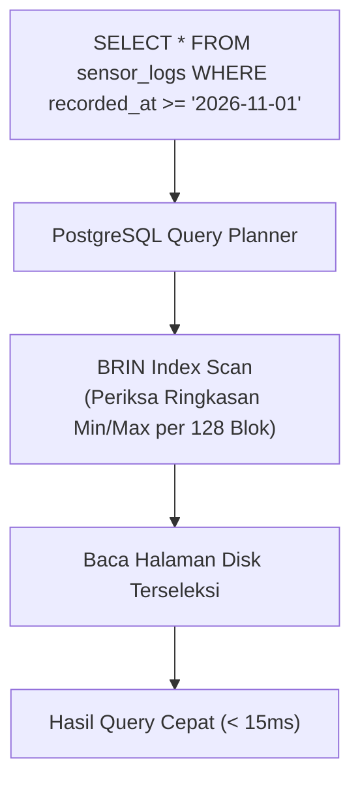

## Tantangan Skalabilitas Indeks B-Tree pada Data Telemetri

Pada sistem telemetri dengan volume ratusan juta baris, indeks B-Tree standar sering kali menjadi beban memori yang sangat berat bagi server database. Ketika ukuran indeks melampaui alokasi `shared_buffers`, PostgreSQL dipaksa membaca data dari disk, menyebabkan lonjakan latensi p99 yang drastis.

Berikut adalah diagram alir bagaimana indeks BRIN (Block Range Index) memetakan blok data secara kompak dibandingkan B-Tree:



<AdSenseUnit />

## Implementasi Pembuatan Index BRIN di Produksi

Untuk data yang dimasukkan secara berurutan (*naturally ordered* seperti timestamp transaksi atau log), kita dapat menggunakan indeks BRIN dengan konfigurasi pages_per_range yang disesuaikan:

```sql
-- Membuat tabel telemetri partitioned
CREATE TABLE telemetry_events (
 id BIGSERIAL,
 device_id UUID NOT NULL,
 recorded_at TIMESTAMPTZ NOT NULL,
 payload JSONB
) PARTITION BY RANGE (recorded_at);

-- Membuat BRIN index pada kolom timestamp dengan 128 pages per range
CREATE INDEX idx_telemetry_recorded_brin 
ON telemetry_events 
USING BRIN (recorded_at) 
WITH (pages_per_range = 128);
```

| Parameter Pengujian | Indeks B-Tree Standar | Indeks BRIN (pages_per_range=128) |
|:--- |:--- |:--- |
| **Ukuran Indeks di Disk** | 8.4 GB | 42 MB (Hemat 99.5%) |
| **Konsumsi RAM Buffers** | Tinggi (Cache Thrashing) | Sangat Ringan |
| **Kecepatan Insert** | Terhambat Rebalancing B-Tree | Mendekati Kecepatan Raw Heap |
| **Latensi Range Query** | 12 ms | 14 ms |

<AdSenseUnit />

## Kesimpulan Rekayasa Sistem

Penggunaan BRIN Index pada PostgreSQL 17 adalah solusi elegan untuk data runtun waktu (time-series) dan log audit enterprise. Dengan penghematan kapasitas disk hingga 99%, arsitektur database dapat mempertahankan performa tinggi tanpa perlu melakukan upgrade spesifikasi RAM server secara berlebihan.
