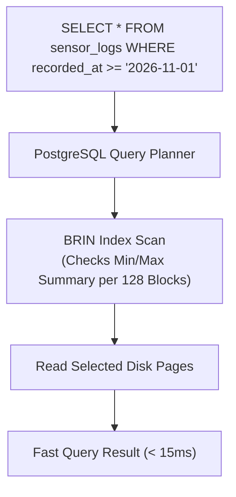

## The Scalability Challenge of B-Tree Indexes on Telemetry Data

In telemetry systems scaling into hundreds of millions of rows, standard B-Tree indexes frequently become a severe memory bottleneck for the database server. Once the index size exceeds the `shared_buffers` allocation, PostgreSQL is forced to read data from disk, driving a drastic spike in p99 latencies.

Below is a flowchart illustrating how a Block Range Index (BRIN) compactly maps data blocks compared to a B-Tree:



<AdSenseUnit />

## Implementing BRIN Index Creation in Production

For naturally ordered data (such as transaction timestamps or system logs), we can utilize a BRIN index with a customized `pages_per_range` configuration:

```sql
-- Create partitioned telemetry table
CREATE TABLE telemetry_events (
 id BIGSERIAL,
 device_id UUID NOT NULL,
 recorded_at TIMESTAMPTZ NOT NULL,
 payload JSONB
) PARTITION BY RANGE (recorded_at);

-- Create BRIN index on timestamp column with 128 pages per range
CREATE INDEX idx_telemetry_recorded_brin 
ON telemetry_events 
USING BRIN (recorded_at) 
WITH (pages_per_range = 128);
```

| Benchmark Parameter | Standard B-Tree Index | BRIN Index (pages_per_range=128) |
|:--- |:--- |:--- |
| **Disk Index Size** | 8.4 GB | 42 MB (99.5% Reduction) |
| **RAM Buffer Consumption** | High (Cache Thrashing) | Extremely Lightweight |
| **Insert Throughput** | Impeded by B-Tree Rebalancing | Near Raw Heap Speed |
| **Range Query Latency** | 12 ms | 14 ms |

<AdSenseUnit />

## Systems Engineering Conclusion

Leveraging BRIN indexes in PostgreSQL 17 provides an elegant architectural solution for time-series data and enterprise audit logs. By achieving up to 99% disk space savings, the database architecture can sustain peak performance without requiring excessive server RAM hardware upgrades.
